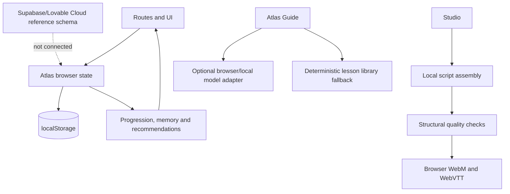

# Atlas architecture assessment

Last reviewed: 26 November 2026

## Executive summary

Atlas is currently a local-first React application with a well-established presentation layer, a central browser state store, deterministic learning utilities, optional local-model adapters and a browser-based Studio. It is not yet a multi-user cloud platform. The prepared Supabase/Lovable Cloud schema is reference material only; there is no active authentication adapter or cloud synchronisation path.

The architecture should evolve through clear modules inside the existing TanStack Start application. There is no evidence that Atlas needs microservices at this stage.

## Current runtime

- React 19 and TypeScript.
- TanStack Start and file-based TanStack Router routes under `src/routes/`.
- Vite build and preview.
- Tailwind CSS and Radix-based UI components.
- Vitest, jsdom and Testing Library.
- A single browser-local Atlas store in `src/lib/atlas-store.tsx`, persisted to `localStorage` under `atlas-progress-v2`.
- Deterministic progression, memory, recommendations and Studio helpers.
- Optional browser on-device model, Ollama and local OpenAI-compatible adapters.
- Supabase/Lovable Cloud backend design in `docs/backend/`, not connected to the running app.

## Current module map

| Boundary | Current implementation | Truthful status |
|---|---|---|
| Presentation and navigation | `src/routes/`, `src/components/`, `src/components/ui/` | Active |
| Learning content | `src/data/` | Local bundled content |
| Learner state | `src/lib/atlas-store.tsx` | Browser-local only |
| Progression | `src/lib/progression.ts`, `src/lib/streak.ts`, achievements | Deterministic local logic |
| Memory and revision | `src/lib/memory.ts` | Local spaced-repetition logic |
| Recommendations | `src/lib/recommend.ts` | Local scoring |
| AI provider adapters | `src/lib/ai/providers.ts` and related files | Browser-to-local endpoint only |
| Agent catalogue | `src/lib/ai/agents.ts` | Capability catalogue, with unavailable stages explicitly marked |
| Studio | `src/lib/studio/`, `src/routes/studio.tsx` | Local draft, structural checks and browser rendering |
| Backend | `docs/backend/README.md`, `docs/backend/schema.sql` | Prepared, not configured |
| Commerce | `src/lib/commerce/types.ts` | Data/calculation preparation only |

## Current data flow

## Architecture principles for the next stages

1. Keep deterministic learning calculations in ordinary TypeScript modules.
2. Keep React components focused on presentation and user interaction.
3. Keep browser persistence behind a store/repository boundary.
4. Introduce a backend adapter only after Lovable Cloud is configured and RLS has passed two-account isolation tests.
5. Treat local progress as durable user data. A failed network request must never replace it with an empty state.
6. Keep AI provider, model, agent and tool concepts separate.
7. Keep production stages independently inspectable and retryable.
8. Keep payments, owner operations and institutional data behind server-side identity and authorisation.
9. Avoid premature microservices; use replaceable internal modules first.

## Target logical boundaries

| Target module | Responsibility | Initial implementation approach |
|---|---|---|
| Identity | Auth session and user identity | Lovable Cloud Auth; server-derived identity |
| Learner profile | Name, preferences and ambitions | Authenticated profile repository |
| Learning state | Progress, mastery, review schedule | Versioned local repository plus sync adapter |
| Content catalogue | Lessons, series, taxonomy and provenance | Existing local data first; reviewed content API later |
| Learning engine | XP, mastery, memory and pathways | Pure deterministic TypeScript |
| AI orchestration | Agent selection, provider routing and budgets | Server-side orchestration after approval |
| Research and verification | Evidence collection and independent review | Separate auditable stages |
| Media production | Draft, assets, captions and rendering | Existing Studio expanded behind job contracts |
| Social | Guilds, messages, collections and moderation | Authenticated domain modules with RLS |
| Commerce | Entitlements, payments and ledger | Server-only verified provider integration |
| Administration | Owner controls, audit and monitoring | Protected server functions and authoritative database reads |
| Institutional | Organisations, classrooms and teacher access | Separate tenant-aware module and policies |

## Known architectural risks

- `src/lib/atlas-store.tsx`, `src/lib/agent.ts` and `src/routes/studio.tsx` are large modules. Refactor only behind focused tests.
- Browser storage and browser-local quotas are user-controlled; neither is an authorisation or financial boundary.
- The AI adapters execute from the browser and can contact a configured local or external endpoint. There is no server proxy or central spend enforcement.
- The backend schema has not been applied. Creator-profile self-update policies were tightened in the reference SQL; live RLS review and two-account tests are still required.
- The Studio pipeline is intentionally honest about unavailable research and narration. Do not relabel structural URL checks as factual verification.

## Current decisions

- Retain React, TypeScript, TanStack Start, Vite and Vitest.
- Retain the local-first learner experience.
- Prefer Supabase/Lovable Cloud as the backend direction already documented in this repository.
- Do not install an auth SDK or apply schema until the owner project is configured and two-account tests can be run.
- Do not enable paid AI fallback, payments or public deployment without explicit approval.

## Required architecture tests

- Pure unit tests for XP, progression, memory, recommendations and merge logic.
- Storage hydration and backup recovery tests.
- Integration tests for authenticated profile and learning-state reads/writes.
- Two-account isolation and cross-user denial tests.
- Server-side admin-role and privilege-escalation tests.
- Production pipeline stage, idempotency and approval tests.
